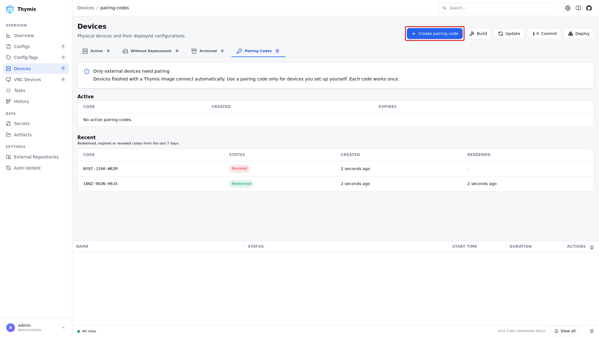
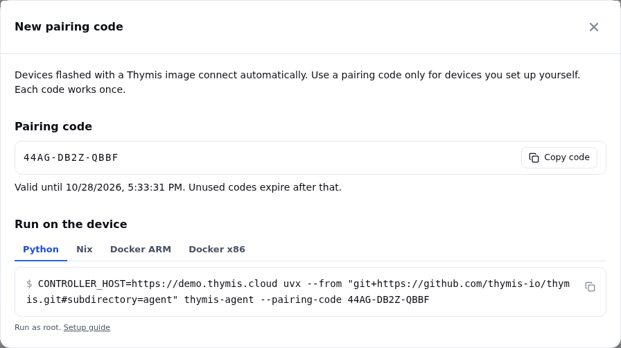
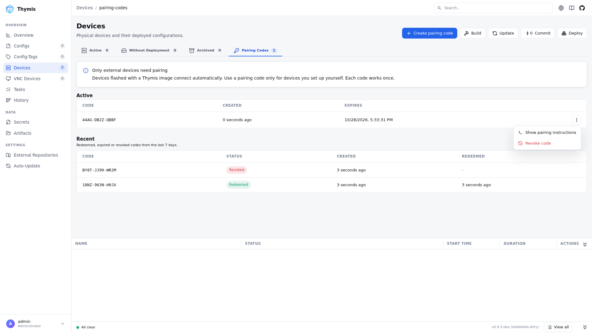

# Connecting External Devices

Devices flashed with a Thymis image connect to the Controller on their own. An external device is one you set up yourself, e.g. an existing Linux server or a Raspberry Pi running another distribution. It connects by running the Thymis agent once with a pairing code.

## Requirements

- Linux, with the agent running as `root`.
- An OpenSSH server listening on `localhost:22` that allows `root` to log in with a public key (`PermitRootLogin prohibit-password` or `yes`) and serves an ed25519 host key (see [SSH host key](#ssh-host-key)). The Controller opens its SSH sessions through the agent's tunnel, so port 22 does not need to be reachable from outside.
- Outbound HTTP(S) access to the Controller's agent URL (see [Firewall Rules](../reference/administration/firewall.md)).
- Deploying Thymis configurations to the device requires NixOS. On other distributions, the device shows up in Thymis and can be reached via the [terminal](ssh-terminal.md), but configurations cannot be deployed to it.

## Pairing codes

Open **Devices → Pairing Codes** and click **Create pairing code**.



The dialog shows the code and a ready-to-copy command for each [start method](#running-the-agent) (Python, Nix, Docker ARM, Docker x86).



- Lifetime: 24 hours. Unused codes expire after that.
- Single use: the first device that redeems a code gets an agent token in exchange and the code is used up. That device can retry with the same code, e.g. after a network error, but any other device is rejected.
- Revoking: an unused code can be revoked from the row menu in the Active table. The row menu also shows the pairing instructions again.
- Recent: redeemed, expired and revoked codes stay listed for 7 days.



The pairing code is only needed once. After pairing, the agent stores its token in `/etc/thymis/thymis-token.txt` and uses it on every later start; a `--pairing-code` argument is then ignored.

## SSH host key

The device is identified by its ed25519 SSH host key, `/etc/ssh/ssh_host_ed25519_key` by default. Most distributions create it when OpenSSH is installed. Check with:

```bash
ls /etc/ssh/ssh_host_ed25519_key.pub
```

If it is missing, create the missing default host keys and reload the SSH server (the service is called `ssh` on Debian and Ubuntu, `sshd` elsewhere):

```bash
ssh-keygen -A
systemctl reload sshd
```

To use a key at another location, e.g. `/etc/thymis/ssh_host_ed25519_key`:

1. Create it: `ssh-keygen -q -t ed25519 -N "" -f /etc/thymis/ssh_host_ed25519_key`
2. Let `sshd` serve it by adding `HostKey /etc/thymis/ssh_host_ed25519_key` to `/etc/ssh/sshd_config`, then `systemctl reload sshd`.
3. Start the agent with `SSH_HOST_KEY_PATH=/etc/thymis/ssh_host_ed25519_key`. The public key must be next to it, at `<path>.pub`.

## Running the agent

All methods take the same configuration:

| Setting                | Description                                                                                                                       |
| ---------------------- | --------------------------------------------------------------------------------------------------------------------------------- |
| `CONTROLLER_HOST`      | Required. The Controller's agent URL, e.g. `https://thymis.example.com` (`THYMIS_AGENT_ACCESS_URL` on the Controller).            |
| `--pairing-code CODE`  | The pairing code. Only needed until the device is paired.                                                                         |
| `MANAGE_HOSTNAME=true` | Optional. Apply the hostname set in Thymis to the device. Off by default.                                                         |
| `DEFAULT_HOSTNAME`     | Optional. Hostname to use while Thymis has not set one. Defaults to `thymis`.                                                     |
| `SSH_HOST_KEY_PATH`    | Optional. Private ed25519 host key of the device. Defaults to `/etc/ssh/ssh_host_ed25519_key`. See [SSH host key](#ssh-host-key). |

Run the commands below as `root` (e.g. in `sudo -i`). Once the log shows `Successfully SSH connected`, the device appears under **Devices → Active**.

### Python

Requires Python 3.11 or newer and `git`.

```bash
python3 -m venv /opt/thymis-agent
/opt/thymis-agent/bin/pip install "git+https://github.com/thymis-io/thymis.git#subdirectory=agent"
CONTROLLER_HOST=https://thymis.example.com /opt/thymis-agent/bin/thymis-agent --pairing-code XXXX-XXXX-XXXX
```

With [uv](https://docs.astral.sh/uv/), installing and running is one step:

```bash
CONTROLLER_HOST=https://thymis.example.com uvx --from "git+https://github.com/thymis-io/thymis.git#subdirectory=agent" thymis-agent --pairing-code XXXX-XXXX-XXXX
```

To keep the agent running, stop it after pairing and install it as a systemd service, e.g. `/etc/systemd/system/thymis-agent.service`:

```ini
[Unit]
Description=Thymis agent
After=network-online.target sshd.service
Wants=network-online.target

[Service]
Type=notify
TimeoutStartSec=infinity
Environment=CONTROLLER_HOST=https://thymis.example.com
ExecStart=/opt/thymis-agent/bin/thymis-agent
Restart=always

[Install]
WantedBy=multi-user.target
```

```bash
systemctl daemon-reload
systemctl enable --now thymis-agent
```

### Nix

With [Nix](../external-projects/packaging-software/setting-up-nix.md) installed:

```bash
CONTROLLER_HOST=https://thymis.example.com nix run github:thymis-io/thymis#thymis-agent -- --pairing-code XXXX-XXXX-XXXX
```

### Docker

Images are published to the GitHub Container Registry:

- x86_64: `ghcr.io/thymis-io/thymis-agent:latest`
- ARM64 (e.g. Raspberry Pi): `ghcr.io/thymis-io/thymis-agent:latest-arm64`

[View all tags on GitHub Container Registry](https://ghcr.io/thymis-io/thymis-agent)

Run it in the host's network namespace, so `localhost:22` is the host's SSH server, and mount the directories the agent reads and writes:

```bash
docker run -d --name thymis-agent --restart unless-stopped \
  --network host \
  -e CONTROLLER_HOST=https://thymis.example.com \
  -v /etc/thymis:/etc/thymis \
  -v /etc/ssh:/etc/ssh:ro \
  -v /root/.ssh:/root/.ssh \
  ghcr.io/thymis-io/thymis-agent:latest --pairing-code XXXX-XXXX-XXXX
```

| Mount         | Purpose                                                                      |
| ------------- | ---------------------------------------------------------------------------- |
| `/etc/thymis` | Agent token and device identity; without it, every restart needs a new code. |
| `/etc/ssh`    | The host's SSH host key, which identifies the device to the Controller.      |
| `/root/.ssh`  | The agent adds the Controller's SSH key to root's `authorized_keys`.         |

With a custom `SSH_HOST_KEY_PATH`, mount the key's directory and pass the path inside the container, e.g. `-e SSH_HOST_KEY_PATH=/etc/thymis/ssh_host_ed25519_key` (already covered by the `/etc/thymis` mount).

[Secrets](secrets.md) are written inside the container unless you also mount their target paths. Follow the logs with `docker logs -f thymis-agent`.

## Troubleshooting

- `Controller rejected pairing code (404)`: the code is unknown, expired, revoked or was redeemed by another device. Create a new one.
- `Agent token not found and no pairing code provided`: the device is not paired yet, or `/etc/thymis` was not persisted. Run the agent with `--pairing-code`.
- Agent keeps reconnecting, device never appears: check that `sshd` listens on `localhost:22` and permits public-key login for `root`.
- Cloned device refused: two devices with the same SSH host keys cannot be connected at the same time. Regenerate the host keys on the clone, delete `/etc/thymis/thymis-token.txt` and pair it with a new code.
- Re-pairing: delete `/etc/thymis/thymis-token.txt` and run the agent with a new pairing code.
