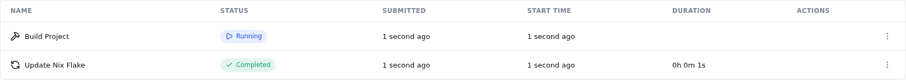
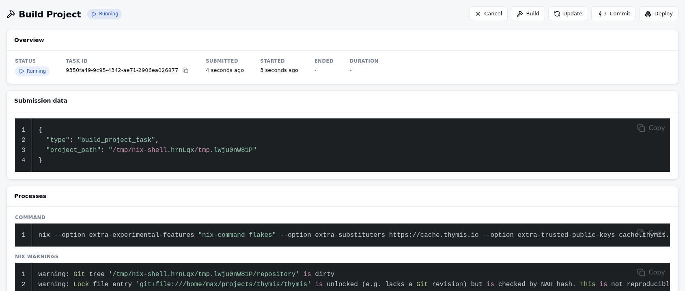

# Tasks

Thymis provides a **task system** to track long-running operations such as builds, updates, deployments, and image generation. All background operations in Thymis appear as tasks in the bottom **Tasks** view.

## Task Status

| State     | Meaning                                                                              |
| --------- | ------------------------------------------------------------------------------------ |
| Pending   | The task is waiting for resources to start.                                          |
| Running   | The task is currently executing.                                                     |
| Completed | The task finished successfully without errors.                                       |
| Failed    | The task ended due to an error. The failure reason can be found in the task details. |

## Subtasks

Some tasks run other tasks as subtasks. **Deploy Devices**, for example, runs one **Deploy to Device** per device, and each of these may reboot its device with **Run SSH Command**. Subtasks are shown indented below the task that started them, in the order they were started. Only the first three are shown at first; click **… N more** to see the rest. Retrying a subtask starts it again as a new top-level task.

A parent task's state sums up its subtasks: once they are all done, it is failed if any of them failed. The state filters and the page count on the tasks page therefore look at top-level tasks only, so a deploy to five devices counts once and its state tells whether all five succeeded.

## Task Types

| Task Type                                       | Description                                                            |
| ----------------------------------------------- | ---------------------------------------------------------------------- |
| [Build Project](build.md)                       | Builds the project configuration and validates all Nix code.           |
| [Deploy to Device](../concepts/deployment.md)   | Deploys a configuration to a single device.                            |
| Deploy Devices                                  | The parent task for Deploy Devices, grouping all deployments together. |
| [Update Nix Flake](update.md)                   | Updates project dependencies to their latest versions.                 |
| [Build Image for Device](../concepts/device.md) | Creates a bootable system image for a specific device configuration.   |
| Run SSH Command                                 | Executes a one-time command on a device over SSH.                      |
| Run NixOS VM for Device                         | Starts a virtual machine instance with a selected configuration.       |

## Task Details

Opening a task shows more information such as:

- Subtasks: all tasks this task started, at every level
- Submission Data: all information used to process the task
- Process: the command that was executed and its arguments
- Downloads and transfers: progress of fetching store paths from caches and copying them to the target device, summed over all processes of the task
- Nix Infos, Warnings, Errors: parsed Nix output, separated by log level
- Standard output: logs generated during execution
- Standard error: warnings and error messages from the process

